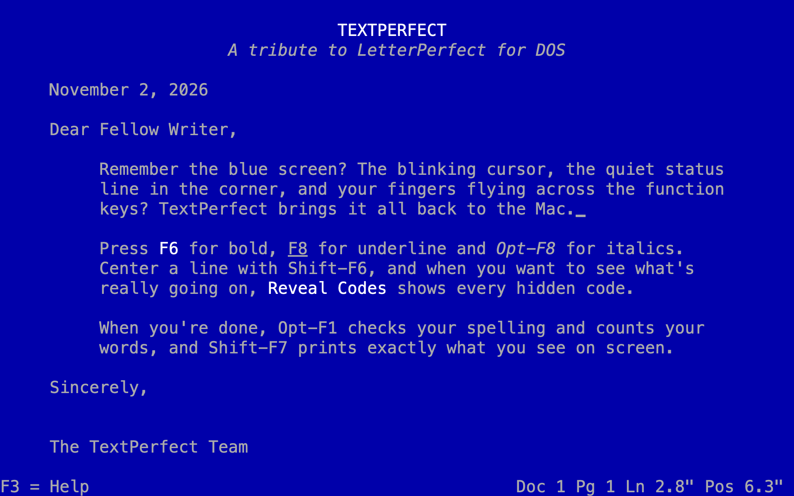
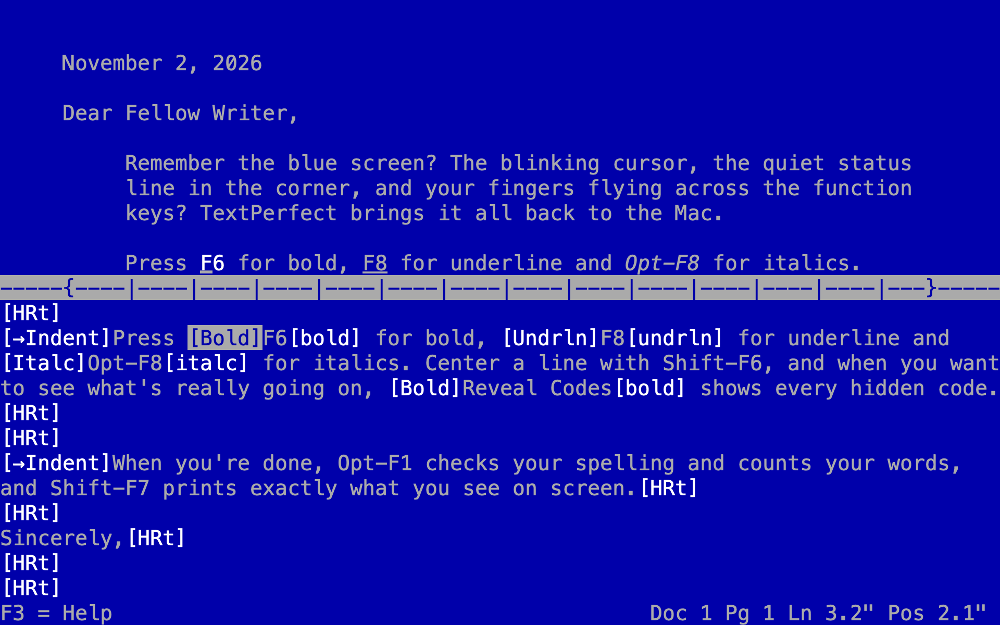
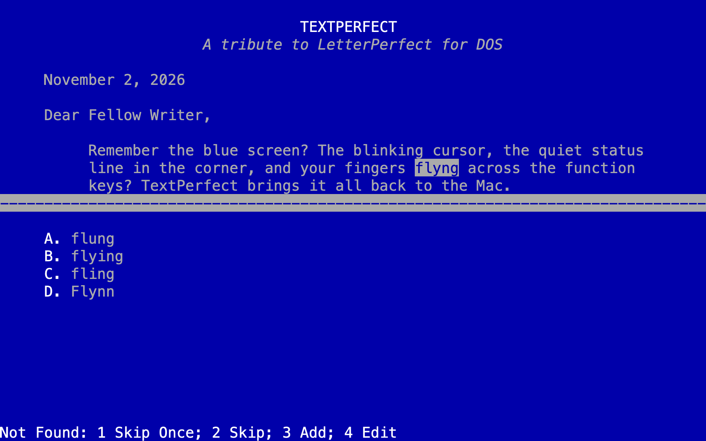
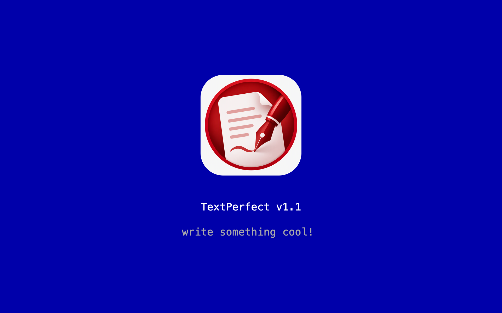

# TextPerfect


**TextPerfect is a tribute to LetterPerfect, the word processor for DOS that WordPerfect Corporation released in 1990.**

LetterPerfect was the lighter sibling of WordPerfect 5.1. It kept the parts most people actually used: the clean blue screen, the function-key commands, Reveal Codes and the one-line status bar. It left out the rest. TextPerfect brings that experience to the Mac as a native app, with an 80 × 25 character screen, the classic blue and grey colours, and the familiar keys. It adds the conveniences you'd expect today, like the mouse, the clipboard, drag and drop, and printing through macOS.



## Download

Get **TextPerfect-1.1.zip** from the [Releases page](https://github.com/traxxtar/TextPerfect/releases/latest). Unzip it and drag **TextPerfect** into your Applications folder.

It runs on any Mac with macOS 12 or later, Apple Silicon or Intel. It's signed with a Developer ID and notarized by Apple, so it opens normally with no security warning.

TextPerfect isn't affiliated with, or endorsed by, WordPerfect Corporation or the current owners of WordPerfect and LetterPerfect. It's a fan-made homage.

## Screenshots

| Reveal Codes | Spell check |
|---|---|
|  |  |
| **Reveal Codes** (Opt-F3 or F11) shows every hidden formatting code. | **Spell check** (Opt-F1) offers lettered suggestions, LetterPerfect-style. |

<p align="center"><br><em>The launch splash (F9 brings it back)</em></p>

## Features

### The classic screen
- An 80-column, 25-row text screen in white and grey on blue, scaled to fill the window at any size.
- A WordPerfect-style status line: `Doc 1 Pg 1 Ln 1" Pos 1"`. Your line and position are in inches, and the `Pos` reading turns bold, underlined or italic to match the text at the cursor.
- Page breaks drawn across the screen: a dashed line for an automatic (soft) break and a double line for a hard page break.
- A launch splash screen that fades out after a few seconds. Press **F9** to bring it back.
- A built-in key reference. Press **F3**.

### Text formatting
- **Bold**, *italic* and <u>underline</u>, which you can turn on and off as you type or apply to a selected block. Bold text shows as bright white, as it did on a DOS screen.
- **Center line**, which centres a line between the margins.
- **Indent**, which moves a whole paragraph in by one 0.5" tab stop each time, wrapped lines included.
- **Hard page breaks** with **Ctrl-Return**.
- **Reveal Codes**, which splits the screen to show the hidden formatting codes (`[Bold]`, `[bold]`, `[Undrln]`, `[Italc]`, `[Center]`, `[→Indent]`, `[HRt]`, `[HPg]`) and lets you delete them directly. Deleting one half of a pair, like `[Bold]`, removes its partner too.

### Editing
- Insert and **Typeover** modes.
- **Block**: select text with the keyboard, Shift-arrow keys or the mouse, then cut, copy, delete or format it.
- **Undo**: up to 200 steps.
- **Search** forward and backward, ignoring upper and lower case.
- **Replace**, either all at once or one match at a time with a Yes/No prompt for each. One Undo reverses the whole Replace.
- **Spell check** (**Opt-F1**), in the LetterPerfect style. TextPerfect works through the document from the top using the macOS spelling dictionary. At each unknown word, the screen splits, with lettered suggestions in the bottom half:
  - Press a suggestion's letter to use that word.
  - **1 Skip Once** skips this occurrence.
  - **2 Skip** skips the word for the rest of the check.
  - **3 Add** adds the word to your macOS dictionary.
  - **4 Edit** lets you type the correction yourself.
  - **Esc** stops the check.

  When the check finishes, the status line shows the number of corrections and the document's word count, e.g. *Spell check done: 3 corrections, 1,204 words*. One Undo reverses every correction from that check.
- **Insert Date**, which types today's date, e.g. "November 2, 2026".
- **Word-wrapped text** at 10 characters per inch between your margins. Tab moves to the next 0.5" stop.

### Files
- **Drag and drop**:
  - Drop a text file on the window to open it.
  - Hold **Option** while you drop to insert the file at the drop point instead.
  - Drop a file on TextPerfect's **Dock icon** to open it, even when TextPerfect isn't running.
- **`.lp` documents** keep all formatting. TextPerfect is the default app for `.lp` files, so double-clicking one in Finder opens it.
- **`.txt` files** are saved as plain text. Formatting codes are dropped, indents and centred lines are padded with spaces, and hard page breaks are written as form feeds.
- **Opens any plain-text file** in UTF-8 or Latin-1, with Mac, Windows or Unix line endings. TextPerfect appears in Finder's **Open With** menu for text files.
- **Retrieve** inserts another file at the cursor, as in WordPerfect.
- A **"Save document?"** prompt before anything would lose unsaved changes.

### Printing
- Prints exactly what you see on screen: the same line breaks and the same page breaks.
- 12 pt monospaced type at 10 characters per inch and 5 lines per inch on 8.5" × 11" paper, with 1" top and bottom margins and 45 lines per page.
- Left and right margins can be set in inches (defaults 1" and 0.5"). TextPerfect remembers them between sessions.

## Function keys

| Key | Action | Opt + key | Shift + key |
|---|---|---|---|
| **F1** | Undo | Spell check | |
| **F2** | Search forward | Replace | Search backward |
| **F3** | Help (key reference) | Reveal Codes on/off | |
| **F4** | Indent paragraph | Block on/off | |
| **F5** | Open file | | Insert date |
| **F6** | Bold on/off | | Center line on/off |
| **F7** | Exit | | Print |
| **F8** | Underline on/off | Italic on/off | Margins |
| **F9** | Show splash screen | | |
| **F10** | Save | | Retrieve file at cursor |
| **F11** | Reveal Codes on/off | | |
| **F12** | Block on/off | | |
| **Insert** | Typeover on/off | | |

**Ctrl-F2**, LetterPerfect's own Spell key, also starts a spell check if you turn off the macOS shortcut that uses it (*System Settings › Keyboard › Keyboard Shortcuts › Keyboard › Move focus to the menu bar*).

> **Tip:** On most Mac keyboards, F1–F12 control brightness, volume and so on by default. Either hold **fn** with the function key, or turn on *System Settings › Keyboard › Keyboard Shortcuts › Function Keys › Use F1, F2, etc. keys as standard function keys*. Mac keyboards without an **Insert** key can switch Typeover on and off from **Format › Typeover On/Off** (**Cmd-T**).

## Other keys

| Key | Action |
|---|---|
| **Ctrl-Return** | Hard page break |
| **Tab** | Move to the next 0.5" tab stop |
| **Esc** | Cancel a block selection, or cancel a prompt |
| **Opt-Left / Opt-Right** (or Ctrl) | Previous / next word |
| **Cmd-Left / Cmd-Right**, **Home / End** | Start / end of line |
| **Cmd-Up / Cmd-Down**, **Cmd-Home** | Start / end of document |
| **Page Up / Page Down** | Up / down one screen |
| **Shift** + any movement key | Extend the selection |
| **Opt-Delete** / **Opt-Forward Delete** | Delete the previous / next word |
| **Ctrl-End** | Delete to the end of the line |

## Menu shortcuts

| Shortcut | Action | Shortcut | Action |
|---|---|---|---|
| Cmd-N | New | Cmd-B | Bold |
| Cmd-O | Open | Cmd-I | Italic |
| Shift-Cmd-O | Retrieve into document | Cmd-U | Underline |
| Cmd-W | Close | Cmd-E | Center line |
| Cmd-S | Save | Shift-Cmd-M | Margins |
| Shift-Cmd-S | Save As | Cmd-R | Reveal Codes |
| Cmd-P | Print | Cmd-K | Block on/off |
| Cmd-Z | Undo | Cmd-T | Typeover on/off |
| Cmd-X / C / V | Cut / Copy / Paste | Cmd-F | Find |
| Cmd-A | Select all | Cmd-G | Find next |
| Cmd-; | Check spelling | | |
| Cmd-Q | Quit | Opt-Cmd-F | Replace |

**Edit › Insert Date** and **Format › Indent** are also in the menus.

## Mouse

- Click to place the cursor. Drag to select a block.
- Scroll with the mouse wheel or trackpad.
- Click or press any key to dismiss the help screen or the splash.

## Building

You need macOS 12 or later and Xcode or the Xcode Command Line Tools.

```sh
./build_app.sh            # builds TextPerfect.app in this folder
./build_app.sh install    # also copies it into ~/Applications
./build_app.sh release    # also notarizes it and makes TextPerfect-<version>.zip
open TextPerfect.app
```

The app is built universal (Apple Silicon and Intel). The version number is set at the top of `build_app.sh`. The script signs with the Developer ID certificate named there if it's in the keychain, and otherwise signs ad hoc, which only runs on the Mac that built it. `release` needs a notarytool keychain profile named `TextPerfect-notary`. You make it once with `xcrun notarytool store-credentials`.

The screen font is **JetBrains Mono NL** if you have it installed. Otherwise TextPerfect uses Menlo.

To change the app icon, replace `Icon.png` and rebuild. `make_icon.swift` regenerates `AppIcon.icns` from it automatically.

## Project layout

| File | What it does |
|---|---|
| `Sources/TextPerfect/ScreenView.swift` | The editor: keys, mouse, drawing, files, search, printing |
| `Sources/TextPerfect/Model.swift` | Formatting codes, line wrapping and pagination |
| `Sources/TextPerfect/PrintView.swift` | Prints pages exactly as they appear on screen |
| `Sources/TextPerfect/AppDelegate.swift` | Window, menus, Dock-icon file drops |
| `build_app.sh` | Builds, signs and optionally installs the app |
| `make_icon.swift` | Makes the app icon from `Icon.png` |

*LetterPerfect and WordPerfect are trademarks of their respective owners.*
